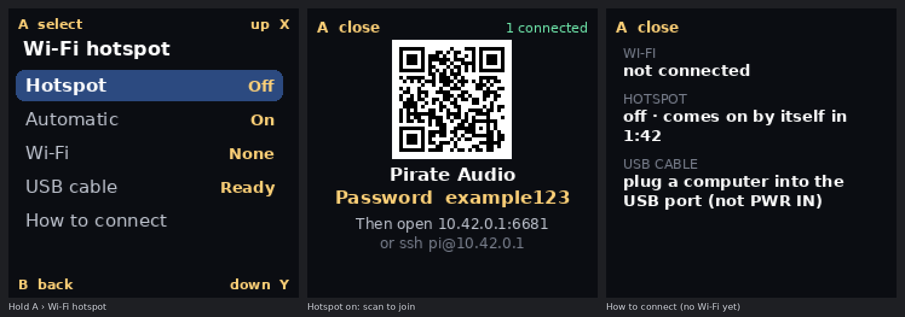

# Pirate Audio Bluetooth add-on

*By potato.*

Pair your iPhone with your Raspberry Pi like a pair of headphones and listen through the **Pirate Audio's
headphone jack**. It works with no Wi-Fi or internet at all, so songs you've downloaded in Apple Music play
anywhere. The Pirate Audio's screen shows the song, artist, album art and progress, and the four buttons
control playback, for your phone and for the music stored on the Pi. Hold **A** for a music menu: browse
the Pi's artists, albums, songs, playlists and folders, see the queue, set repeat and shuffle, and switch
between your phone and the Pi's music.


It also adds a **music page** for your PC or phone: open `http://raspberrypi.local:6681`, drop songs or whole
album folders on it, and they go straight into the Pi's Music folder, ready to play in Mopidy. The same page
lets you **download music from the Pi** back to your computer (single songs, whole folders, or everything),
**check an Apple Music playlist**: which of its songs are already on the Pi, with a choice when it isn't
clear, saved as a playlist for the Pi. Paste a **SoundCloud link** and songs whose artist offers a download
come straight to the Pi. A **Settings** card changes the add-on's settings without SSH.

**You can always get back in.** If the Pi can't join a Wi-Fi it knows (you're somewhere new, or the Wi-Fi
settings got damaged), it makes **its own Wi-Fi hotspot** after 3 minutes, or when you pick it in the menu.
Join it from your phone or laptop (the screen shows a QR code your iPhone's camera can join), then SSH in or
open the music page and add the Wi-Fi. On Trixie a **USB cable** to a computer works too.

**One script installs everything**, on Raspberry Pi OS **Trixie** or **Bookworm** (it works out which one it's
on). On a fresh SD card it also sets up the Pi's music player (Mopidy with the Iris web page), so you don't
need anything else. On Trixie your iPhone also **sends the album art over Bluetooth** itself.

**Pimoroni's Pirate Audio software keeps working.** Mopidy, its web page (Iris) and your music all stay, and
Mopidy keeps running the whole time. The one thing the installer changes in Mopidy's settings is switching
off its own now-playing screen and button handler (PiDi and raspberry-gpio), because the add-on now runs the
screen and buttons for both sources and does everything they did (and more). `uninstall.sh` switches them
back on. If you'd rather keep Pimoroni's screen, install with `--keep-pimoroni-screen`: the add-on then only
borrows the screen and buttons while your phone plays, without the music menu.

## What you need

- A Raspberry Pi with built-in Bluetooth (Zero 2 W, 3, 4 or 5) and a Pimoroni Pirate Audio board
- **Raspberry Pi OS Lite**, Trixie (recommended: album art straight from your phone) or Bookworm. The
  installer stops if it finds a desktop sound system.
- Internet on the Pi while installing. Pimoroni's Pirate Audio software isn't needed: if Mopidy isn't
  there, the installer sets it up. If it is (Pimoroni's installer on Bookworm), it's kept as it is.

## Install

Copy this folder onto the Pi (from Windows PowerShell: `scp -r pirate-audio-bluetooth pi@raspberrypi.local:~`), then:

```bash
cd pirate-audio-bluetooth
bash install.sh --check   # see exactly what would change - changes nothing
bash install.sh           # install (it asks first)
```

Reboot when it asks. That's all: the same script does the whole install on Trixie and on Bookworm.
What it checks and sets up:

- **Which system it's on** (Trixie or Bookworm) and its Bluetooth version. It shows both before changing
  anything.
- **The Pirate Audio hardware settings** in `config.txt`, if they're missing (sound chip and screen). On
  Trixie that includes `dtoverlay=spi0-2cs,no_miso`: Trixie's SPI driver otherwise holds GPIO9, which the
  Pirate Audio uses as the screen's data/command pin, and the screen only lights up without a picture.
- **The Pi's music player**, if Mopidy isn't installed: Mopidy 3.4 with its music library (Mopidy-Local)
  and the Iris web page (`http://raspberrypi.local:6680/iris`), the same layout Pimoroni's installer uses,
  playing from `~/Music`. It's Mopidy 3.4 rather than the brand-new Mopidy 4 because Iris doesn't work with
  Mopidy 4 yet. On Trixie the installer also applies a small fix Mopidy 3.4 needs there (from Mopidy 4).
- **On Trixie: album art from your phone over Bluetooth** (BlueZ's cover-art support and `bluez-obexd`).
- **A way in when there's no Wi-Fi:** the Wi-Fi hotspot (all Pis with NetworkManager, i.e. Bookworm and
  Trixie) and, on Trixie with a Pi Zero, 4 or 5, a network over a USB cable (Raspberry Pi's own
  `rpi-usb-gadget`). It also turns off Wi-Fi power saving (it can make a Pi drop off Wi-Fi and stay off) and,
  on Trixie, moves empty network settings files aside at boot (a power cut while saving one can stop the Pi
  joining any Wi-Fi).
- Bluetooth audio, the screen and buttons, the music page, and starting everything at power-on.

Options: `--name "…"`, `--y-pin 20` for early boards, `--upload-port 8090` if port 6681 is taken,
`--no-upload` to skip the music page, `--latency low` for less audio delay (see below),
`--keep-pimoroni-screen` (see above), `--no-mopidy` (Bluetooth only: don't install Mopidy on a Pi that
doesn't have it), `--no-phone-art` (don't set up album art over Bluetooth), `--no-hotspot` and `--no-usb`.
Running `install.sh` again updates the add-on and keeps your settings.

Nothing is compiled: Raspberry Pi OS packages, plus Mopidy and Iris from the Python package index the way
Pimoroni installs them. The install takes a few minutes (a bit longer when it sets up Mopidy).

### Starting over on a fresh SD card (Trixie)

1. **Save your music first.** Reformatting erases the card. Run `bash install.sh` from this version on your
   current card (it updates the add-on in place), then on the music page open *Download from the Pi* and
   click *Download all* (see below). Or copy it from your PC with `scp -r pi@raspberrypi.local:~/Music .`
   (use your user name and Pi name).
2. Flash **Raspberry Pi OS Lite** (Trixie is the current version) with Raspberry Pi Imager. In its
   settings, set the user name, Wi-Fi and SSH so you can log in. A Pi Zero 2 W only sees 2.4 GHz Wi-Fi.
3. Copy this folder onto the Pi and run `bash install.sh` as above. No need for Pimoroni's installer.
4. After the reboot, pair your phone again (the new system doesn't know it) and drop your music back on the
   music page. Check and save your Apple Music playlists again. If you use the PC helper, download it again
   from the music page and run its `-Install` line once: this version notices a fresh Pi and sends it all the
   songs it doesn't have (older versions remembered what they'd sent before and skipped those).

## Pair your phone (once)

1. The first time, the screen shows **Pairing mode** by itself. After that: hold **A** and pick
   **Pair a new phone**. Over SSH: `pirate-bluetooth pair`.
2. On the iPhone, go to **Settings → Bluetooth** and tap **Pirate Audio**.
3. Both screens show the same 6-digit code. Press **A** on the Pirate Audio and tap **Pair** on the iPhone.

After that it works like headphones. When you switch the Pi on, it connects to your iPhone by itself: it keeps
trying for 3 minutes, so it's fine if the phone is still in your pocket or asleep. You can also pick
**Pirate Audio** in Control Center at any time. Plug your headphones into the Pirate Audio and play.

## When you can't reach the Pi: the hotspot and the USB cable



**The Wi-Fi hotspot.** The Pi makes its own Wi-Fi, so your phone or laptop can always reach it:

- **By itself:** after 3 minutes without a Wi-Fi it knows (after power-on, or when your Wi-Fi goes away). The
  screen says so. While nobody is connected to it, it looks for your Wi-Fi again every 5 minutes, and goes
  off once the Pi is back on your Wi-Fi.
- **From the menu:** hold **A** → **Wi-Fi hotspot** → **Hotspot**. If the Pi is on a Wi-Fi, press **A**
  twice (it leaves that Wi-Fi). **Automatic** switches the by-itself part on or off.
- **How to connect** shows its name and password, and a **QR code**: point your iPhone's camera at it and
  tap *Join*. Then open **`http://10.42.0.1:6681`** (the music page) or `ssh you@10.42.0.1`.
- On the music page's **Wi-Fi and hotspot** card you can then add the Wi-Fi the Pi should use (pick it from
  the list of networks around, type the password, *Save and switch to it*). The hotspot goes off and the Pi
  joins it; if the password was wrong, the hotspot comes back within a minute so you can try again.
- Phones on the hotspot keep their mobile data for the internet (the Pi doesn't offer them a way out), so
  your iPhone doesn't lose the internet while it's joined.
- The name is the Bluetooth name (*Pirate Audio*), and the installer makes up a password. Change either in
  **Settings** on the music page. Over SSH: `pirate-bluetooth hotspot` (and `hotspot on|off`).

**The USB cable (Raspberry Pi OS Trixie; Pi Zero, Zero 2 W, 4 or 5).** The installer switches on Raspberry
Pi's own USB networking (`rpi-usb-gadget`). Plug a computer into the Pi's **USB** port (on a Zero: the
micro-USB port marked *USB*, not *PWR IN*; on a Pi 4/5: the USB-C port), wait a minute, then
`ssh you@raspberrypi.local` or `ssh you@10.12.194.1`, or open `http://10.12.194.1:6681`. On Windows, install
Raspberry Pi's driver once first: **rpi-usb-gadget-driver-setup.exe** from
[github.com/raspberrypi/rpi-usb-gadget/releases](https://github.com/raspberrypi/rpi-usb-gadget/releases).
Use a data cable (some only charge) and plug it straight into the computer, not a hub. That port then works
for this only: a USB keyboard or memory stick won't work in it (`uninstall.sh` gives it back).

## Add music from your PC or phone (and download it back)


Open **`http://raspberrypi.local:6681`** in a browser on the same Wi-Fi. Use your Pi's name if it isn't
`raspberrypi`. The exact address is also on the Pirate Audio's info screen: hold **A**.

- **On a PC:** drag songs or whole album folders onto the page, or use *Choose files* / *Choose a folder*.
  Folders keep their Artist/Album layout, and album covers and playlists inside them come along.
- **On an iPhone:** tap *Choose files* and pick songs from the Files app.
- **Songs already on the Pi** are recognised and not sent again, so you can re-drop a whole folder after adding
  a few songs to it.
- **Formats:** MP3, M4A/AAC, FLAC, WAV, AIFF, OGG, Opus and more. WAV files usually carry no artist or album
  info, so Mopidy lists them by file name (under *Tracks* and *Files*) rather than under an album.
- **Copy-protected Apple Music/iTunes files (`.m4p`) and non-music files** are skipped, and the page says why.
- **When the uploads finish,** Mopidy's library refreshes by itself in the background, with no restart and no
  interruption. The songs show up in Iris under *Browse → Local media* (or *Files*). If Mopidy couldn't read a
  song, or its library is switched off, the page says so.

### Check an Apple Music playlist

Under **Check an Apple Music playlist**, paste a playlist's link (in the Music app: open the playlist, tap
**⋯ → Share Playlist → Copy**) and click **Check**. The Pi reads the playlist's song list and compares it with
the music on the Pi:

- **On the Pi:** the song is there (by its artist and title tags, or its file and folder names), and the
  page shows which file it found.
- **Pick one:** something similar is there, but it might not be the same: another version (remix, VIP,
  live, edit), a different spelling, no artist in the file name, or a different length. Pick the right
  file, or **None of these**. **Change** on any ticked-off song lets you correct it too.
- **Not on the Pi:** with links to get it. The **iTunes Store** link opens the song to buy it: bought songs
  are normal, unprotected `.m4a` files (download them in the Apple Music app or iTunes on your PC), so you can
  drop them on this page. **Bandcamp** sells a lot of music as WAV or FLAC, and on **SoundCloud** some
  artists offer free downloads. The Pi doesn't download anything from these sites itself.

**Save as a playlist on the Pi** makes a Mopidy playlist of the songs that are on the Pi, in the playlist's
order: hold **A** → **Playlists** on the Pirate Audio, or find it in Iris. Your picks are remembered, and when
you drop missing songs on the page, the check runs again by itself. Save again to update the playlist.

### Playlists that keep themselves up to date

With **Keep it in sync** ticked (it is by default), a saved playlist looks after itself:

- **Every 6 hours** the Pi reads the Apple Music playlist again, so songs you add or remove on your phone
  follow on the Pi too.
- **About a minute after new music arrives** (dropped on the page, or sent by the PC helper below), the Pi
  matches the playlist again and adds the songs that are now there. You don't have to save again.
- Clear matches and your picks go in; songs that need a pick or aren't on the Pi yet wait.

**Your playlists on the Pi** on the music page lists them, with how many songs are there, **Sync now**,
**Stop syncing** / **Keep in sync**, and **Forget** (stops syncing; the Pi's playlist stays). Change how often it
checks with `sync_hours` under `[upload]` in `settings.ini`.

**Icons:** a playlist can use **Apple's picture** for it (the default when Apple has one), **your own
picture** (*Choose icon…*: any JPEG, PNG, WebP or GIF; it's cropped to a square), or none. The icon shows on the
music page and on the Pirate Audio: next to the playlist's name in **Playlists**, and next to the title while you
look through its songs. (Iris shows its own picture for playlists; it can't show these.)

### Getting the missing songs

**Get missing songs** (on *Your playlists on the Pi*) lists every song from your synced playlists that isn't on
the Pi yet, each with its iTunes Store, Bandcamp and SoundCloud links, and **Copy the list** puts them on your
clipboard as "Artist - Title" lines. Buying or downloading them is up to you; everything after that is
automatic (see the PC helper below, or paste SoundCloud links in *Get songs from SoundCloud*).

### Get songs from SoundCloud

Under **Get songs from SoundCloud**, paste a link to a song, an album or a playlist (in the SoundCloud app:
**Share → Copy link**; the `on.soundcloud.com` links work) and click **Look it up**. For each song:

- **Download offered:** the artist switched on SoundCloud's download button. Tick the songs and click
  **Download to the Pi**: the Pi downloads the artist's own file (often a WAV or their full-quality master)
  into `~/Music/SoundCloud/<Artist> - <Title>/` with its cover, and it shows up in the Pi's music (the menu,
  Iris, and synced playlists that were waiting for it).
- **No download:** the page shows the artist's own link instead (their *Buy* or *Free Download* page, if
  they set one), the song on SoundCloud, and a Bandcamp search. The Pi doesn't record streams.
- **On the Pi:** it's already there (the page shows which file).

SoundCloud only gives the artists' downloads to signed-in listeners, so the first time the page asks you to
sign in: drag the **Send my SoundCloud sign-in to the Pi** button to your bookmarks bar, open soundcloud.com
(signed in) and click the bookmark; it brings you back, signed in. (Or copy the `oauth_token` cookie by hand,
as the page explains.) The sign-in stays on the Pi, only readable by your user, and the page never shows it;
**Sign out** forgets it, and so does `uninstall.sh`. SoundCloud gives out no API keys, so this uses the same
API the SoundCloud website does; if SoundCloud changes it, the page says it can't read the link.

### Send new music from your PC by itself (Windows)

The **Send new music from this PC by itself** card on the music page (on a PC) has a small helper for Windows.
It watches your music folders and sends new songs to the Pi in the background, keeping their Artist/Album
folders and skipping songs that are already there:

- songs you buy in **iTunes** or the **Apple Music app** (it watches their music folders),
- anything you put in **`Music\Pirate Audio`** (it makes that folder): unzipped Bandcamp downloads, free
  SoundCloud downloads, your own files.

1. Click **Download the helper**.
2. In the Downloads folder, click in the address bar, type `powershell` and press Enter. Then run:
   `powershell -ExecutionPolicy Bypass -File pirate-sync.ps1 -Install`
3. That's it: it runs now and starts with Windows. `-Uninstall` stops it. Other folders:
   `... -Install -Folders "D:\Music\Bandcamp"`. If the music page has a password, add `-Password "..."` (it's
   kept encrypted for your Windows user). What it did: `%LOCALAPPDATA%\PirateSync\log.txt`.

Once a song lands on the Pi, synced playlists pick it up a minute later. Nothing on your PC is changed or
deleted, and copy-protected Apple Music subscription downloads are skipped (the Pi can't play them).

Good to know: songs downloaded with an Apple Music subscription are copy-protected, so they can't be copied
to the Pi (play those from your phone over Bluetooth). Apple has no official way to read playlists without
a paid developer account, so this reads Apple's public web page for the playlist. Apple's page only lists
roughly the first 100-300 songs of a long playlist (the page says so when that happens), and if Apple
changes the page, the check says it can't read it until the add-on is updated.

### Settings

The **Settings** card at the bottom of the music page changes the add-on's settings: the Bluetooth name,
connecting to your phone at power-on, album art, when the screen turns off, an upside-down screen, the Y-button
pin on early boards, the volume step, how often synced playlists are checked, a password for the page, and
the hotspot's name, password and timing. Save, and the part that uses them picks them up by itself (the
screen program restarts for a few seconds; the music keeps playing). It edits
`~/.config/pirate-bluetooth/settings.ini`, keeping your comments. The hotspot settings can only be seen and
changed when you're connected through the hotspot or the USB cable (or the page has a password), so someone
else on a shared Wi-Fi can't read the hotspot password or switch the Pi to another Wi-Fi.

### Download music from the Pi

Under **Download from the Pi** on the same page you can look through the Music folder (click a folder to
open it; your browser's Back button goes back up) and:

- **download a song** with the arrow next to it;
- **download a whole folder** (an album, an artist) as a `.zip` with the arrow next to the folder, or with
  *Download folder* at the top while you're in it;
- **download everything** with *Download all* at the top level: one `Music.zip` with all your folders.

The `.zip` files aren't compressed (music files don't get smaller), so they come out the same size as the
music and start downloading straight away, even for a big library. Unzip them to get the folders and songs
back exactly as they are on the Pi. Album covers and playlists come along. If a big download is interrupted,
a single song carries on where it stopped; a `.zip` has to start again.

The page only works on your local network. If you use the Pi on shared Wi-Fi (campus, café…), set a password
under `[upload]` in `settings.ini`, then run `systemctl --user restart pirate-upload`. The password protects
downloads too.

## Buttons

| Button | Now-playing screen | Hold |
|---|---|---|
| **A** (top left) | Play / pause | Music menu |
| **X** (top right) | Next song | Previous song |
| **B** (bottom left) | Volume down | Keeps going |
| **Y** (bottom right) | Volume up | Keeps going |

The buttons control whatever is on screen: your phone (its name is shown at the top) or the Pi's own music
(*Pi music* at the top, with ↻ for repeat and ⇄ for shuffle). Volume is like Pimoroni's: for the Pi's
music, B and Y change Mopidy's volume (the same one Iris shows); for the phone they turn the headphone amp
up and down, separately from the phone's own volume.

- **Code screen:** **A** accepts, **B** cancels.
- **Info screen:** **X** pairs a new phone, **A** closes it.
- **Screen off:** it turns off after 2 minutes with nothing playing. Any button wakes it; that first press
  only wakes it, so you don't skip a song by accident.

### The music menu (hold A)

| In the menu | |
|---|---|
| **X** / **Y** | Up / down (hold to scroll faster) |
| **A** | Open, or play the song |
| Hold **A** on a song or album | Add it to the queue |
| **B** | Back (closes the menu at the top) |

- **Switch to Pi music / Switch to your phone:** pauses one and carries on with the other.
- **Artists** → albums → songs, **Songs A–Z**, **Playlists** (from Iris, or uploaded `.m3u` files) and
  **Folders** (the Music folder as it is; handy for files without artist/album info, like most WAVs).
  Picking a song plays it with the rest of that album, list or folder queued after it.
- **Queue:** what's playing now (♪) and what's next; pick one to jump to it.
- **Repeat** (off, all, one song) and **Shuffle**.
- **Wi-Fi hotspot:** switch the hotspot on or off, *Automatic*, and *How to connect* (Wi-Fi, music page
  address, hotspot name and password with a QR code, and the USB cable). See above.
- **Pair a new phone** and **Info** (name, connected phone, headphone volume, the music page address).

Artists and Songs A–Z need Mopidy's music library (Mopidy-Local). If the menu says it's off, see
Troubleshooting.

### Switching between your phone and the Pi

- **Start music on your phone** and it takes over: the Pi's music stops at its spot.
- **Pick a song in the menu, or press play in Iris,** and the Pi's music takes over: your phone is paused.
- **Or use the menu's Switch item** to go back and forth. The Pi's music carries on from the same song and
  spot.

Only one of them can use the Pirate Audio's sound chip at a time, which is why the other one pauses.

### Right after you switch it on

The first press of **A** plays whatever you listened to last:

- **Your phone was last:** the screen shows *Connecting…*, then your phone's name. Press **A** and your
  phone starts playing.
- **The Pi's music was last:** your queue is back where it was, paused. Press **A** to carry on. Your phone
  still connects in the background.

### Album art

- **The Pi's music:** the album art inside your music files (through Mopidy's library), or a cover picture
  in the album's folder (`cover.jpg`, `folder.jpg`…).
- **Your phone, on Trixie:** the iPhone sends the album art itself over Bluetooth, the way car stereos get
  it. It works offline, and it's the exact picture your phone shows. This needs Bluetooth software newer
  than Bookworm's (BlueZ 5.79+; Trixie has 5.82), which is why it's Trixie only. The phone starts sending
  pictures from the song after it connects, so the song that's already playing gets the online lookup.
- **When the phone doesn't send one** (on Bookworm, or for a song the phone has no art for), and the Pi is
  online, the add-on looks the cover up in Apple's iTunes catalogue by artist and album name (only those
  names are sent).
- Either way a copy is kept for each album, so it shows straight away (and offline) next time. In
  `settings.ini` under `[bluetooth]`, `phone_art = no` stops asking the phone and `art_lookup = no` stops
  the online lookup. Without art, the screen shows a colored card for each album.

## How it shares with Mopidy

- **Mopidy keeps running all the time.** The add-on talks to it over its web API, the same way Iris does,
  so Iris and the add-on's screen always agree.
- **Mopidy's queue survives reboots and power cuts.** Normally Mopidy starts empty after a reboot. The
  add-on writes the queue down while Mopidy runs and puts it back (paused, at the same spot) when Mopidy
  starts again. Mopidy's own settings aren't changed for this.
- **With `--keep-pimoroni-screen`** the add-on uses its older way: while your phone plays, Mopidy is paused
  out of the way and the add-on borrows the screen; a minute after the phone stops (or right away when it
  disconnects), "Back to Mopidy…" appears and Mopidy comes back with its queue where it was.

## Audio delay (latency)

Bluetooth audio always lags a little behind the phone. The Pi's share of that is the buffer it keeps to
ride out radio hiccups, and you can choose its size:

```bash
pirate-bluetooth latency          # show the current setting
pirate-bluetooth latency low      # about 0.1 s on the Pi: snappiest
pirate-bluetooth latency normal   # about 0.2 s (the default)
pirate-bluetooth latency safe     # about 0.5 s: BlueALSA's own default, most robust
```

A smaller buffer makes play/pause and volume feel quicker and brings videos closer to lip sync. The cost is
more chance of a crackle or dropout when the radio is busy, for example during a big Wi-Fi transfer (the
Pi's Wi-Fi and Bluetooth share one chip). If `low` crackles, go back to `normal`. The phone and the Bluetooth
link add roughly another 0.1-0.2 s that the Pi can't change.

## Commands

```bash
pirate-bluetooth                     # status: name, pairing mode, paired phones, where album art comes from
pirate-bluetooth pair                # pairing mode for 3 minutes
pirate-bluetooth name "My Pirate"
pirate-bluetooth forget "My iPhone"   # or: forget all
pirate-bluetooth library             # is Mopidy's music library (Mopidy-Local) on?  "library on" fixes it
pirate-bluetooth latency low         # less audio delay (low / normal / safe)
pirate-bluetooth logs                # recent log lines; "logs -f" keeps watching
pirate-bluetooth logs upload         # just one part: screen, upload, audio, network or mopidy
pirate-bluetooth hotspot             # the hotspot: name, password, on/off;  "hotspot on|off|auto-on|auto-off"
pirate-bluetooth wifi                # saved Wi-Fi networks and what's in range
pirate-bluetooth wifi add "Name"     # save a Wi-Fi (asks for its password);  also: wifi forget/join "Name"
pirate-bluetooth doctor              # why the screen or buttons aren't working, and what to do
pirate-bluetooth screen-test         # test picture on the screen, and shows which buttons you press
```

Settings are in `~/.config/pirate-bluetooth/settings.ini` (most of them are on the music page's Settings
card too). They include how long it looks for your phone
after power-on (`reconnect_seconds`), album art from the phone (`phone_art`) and the online lookup
(`art_lookup`), how often synced playlists are checked (`sync_hours`), when the screen turns off
(`sleep_after`, 0 = never), the Y-button pin on early boards, screen rotation and the volume step.
After editing, run `systemctl --user restart pirate-bluetooth`.

## Good to know

- **Apple Music downloads stay on your phone.** The phone plays them and sends the sound over Bluetooth, so
  offline listening works anywhere.
- **No album art at all** (offline on Bookworm, or a song nobody has art for): the screen draws a colored
  card for each album instead.
- Bluetooth audio uses a standard Bluetooth codec, so it's slightly lower quality than a wired or AirPlay
  connection, but fine for headphones.
- Everything starts at power-on, with no login needed. If your user services (Mopidy's included) only
  started at login before, the installer turns on "linger" for your user, as Pimoroni suggests for Mopidy.

## Troubleshooting

- **The iPhone doesn't list "Pirate Audio".** It only appears in pairing mode: hold A and pick *Pair a new
  phone*, or run `pirate-bluetooth pair`.
- **The phone doesn't connect by itself after power-on.** Check that the phone's Bluetooth is on and that
  it lists "Pirate Audio" under My Devices. The Pi only looks for 3 minutes after power-on; after that, press
  **A** or pick it in Control Center. If it never connects by itself, `pirate-bluetooth logs screen`
  shows what happened.
- **Connected, but no sound.** Press Y a few times (headphone volume) and check the phone's volume. Then check
  `systemctl status pirate-bluealsa pirate-bluealsa-aplay`.
- **Y does nothing.** Boards made before 23 January 2020 use BCM 20. Set `y_pin = 20` in `settings.ini`.
- **Picture upside down.** Set `rotation = 270` in `settings.ini`.
- **The music page doesn't open.** Check that your PC or phone is on the same Wi-Fi as the Pi, and try the IP
  address from the info screen instead of `raspberrypi.local`. Then check `systemctl --user status pirate-upload`.
  Some campus and public networks block devices from reaching each other.
- **The screen only lights up (no picture), or the buttons do nothing.** Run `pirate-bluetooth doctor`. It
  checks the usual reasons (SPI not on yet, a reboot still needed after installing, another program using the
  Pirate Audio's pins, the screen program not running) and says what to do. `pirate-bluetooth screen-test`
  then draws a test picture and shows each button you press, on its own. The screen program keeps trying by
  itself, so once the cause is fixed the screen comes on without restarting anything, and the screen works
  even when the buttons don't (and the other way round). If Pimoroni's screen extension is still on
  (Mopidy's screen comes back), run `bash install.sh` again.
- **Uploaded songs don't show in Mopidy's Local media (or Iris's Artists/Albums/Tracks, or the menu's
  Artists and Songs A–Z).** They're always under *Browse → Files* (and the menu's *Folders*). If Local media is missing or stays empty, run `pirate-bluetooth library`. Pimoroni's
  installer saves Mopidy's settings as they were at install time, and if Mopidy-Local had a hiccup at that
  moment, it stays switched off from then on. `pirate-bluetooth library on` switches it back on: it adds one
  line to `~/.config/mopidy/mopidy.conf` (keeping a copy of the old file), restarts Mopidy with its queue
  put back, and adds your music to the library. `pirate-bluetooth logs upload` shows any songs Mopidy couldn't
  read.

- **No album art from the phone on Trixie.** Run `pirate-bluetooth`: the *Phone album art* line says what's
  missing (it should read "sent by the phone over Bluetooth…"). After the installer's reboot, turn the
  iPhone's Bluetooth off and on once. `pirate-bluetooth logs screen` shows whether the phone offered art
  ("Connected to the phone for album art over Bluetooth"). Some apps don't share art; the online lookup
  covers those when the Pi is online.
- **Can't reach the Pi at all** (no SSH, no music page). Wait 3 minutes after power-on and look for the
  Pi's own Wi-Fi (*Pirate Audio*) on your phone, or hold **A** → **Wi-Fi hotspot** → **How to connect**.
  Join it and open `http://10.42.0.1:6681` to add your Wi-Fi.
- **The hotspot doesn't come on.** `pirate-bluetooth hotspot` says why (for example a missing permission:
  run `bash install.sh` again). `pirate-bluetooth logs network` has the details.
- **The USB cable connection doesn't show up on Windows.** Install Raspberry Pi's driver
  (`rpi-usb-gadget-driver-setup.exe`, see above), use the port marked *USB* (on a Zero), a data cable, and a
  port on the computer itself rather than a hub. *Code 43* in Device Manager usually means a charge-only or
  flaky cable or not enough power: try another cable or port. It only works on Trixie, after the reboot that
  follows the install.
- **SoundCloud says the sign-in expired.** Click the bookmark on soundcloud.com again. If the bookmark says
  it can't see the sign-in, use the by-hand way on the page.
- **A .zip download fails part-way.** The Pi stops a `.zip` it couldn't finish (for example when a file
  can't be read), so the browser shows it as failed instead of saving a broken file. Try again, or download
  that folder's songs one at a time; `pirate-bluetooth logs upload` names the file.

## Uninstall

```bash
bash uninstall.sh           # undoes exactly what install.sh changed (it kept a record)
bash uninstall.sh --purge   # also removes settings.ini and the extra packages it installed
```

## What gets changed

| What | Where | Undone by uninstall.sh |
|---|---|---|
| BlueALSA package (Bluetooth audio) | `bluez-alsa-utils`, only if missing | removed |
| Bluetooth audio services | `pirate-bluealsa`, `pirate-bluealsa-aplay` | removed |
| "Pirate Headphone" volume control | a marked block in `/etc/asound.conf` (backed up) | removed |
| Audio delay setting | `/etc/default/pirate-bluetooth-latency` | removed |
| Shows up as headphones on phones | one line in `/etc/bluetooth/main.conf` (backed up) | original line put back |
| Album art over Bluetooth (Trixie) | `Experimental = true` in `/etc/bluetooth/main.conf`; packages `bluez-obexd`, `dbus-user-session` (if missing) | line removed; packages removed with `--purge` |
| Pirate Audio hardware (only if missing) | `dtoverlay=hifiberry-dac`, `gpio=25=op,dh`, `dtparam=spi=on` (and on Trixie `dtoverlay=spi0-2cs,no_miso`) in `config.txt` | left in (the Pirate Audio needs them) |
| Mopidy, Mopidy-Local, Iris (only if Mopidy wasn't installed) | `~/.virtualenvs/mopidy`, user service `mopidy`, `~/.config/mopidy/mopidy.conf`, GStreamer packages | removed; with `--purge` also `mopidy.conf`, Mopidy's library index and the packages; your music stays |
| Screen/buttons/pairing program | `~/.local/share/pirate-bluetooth`, user service `pirate-bluetooth` | removed |
| `pirate-bluetooth` command | `/usr/local/bin` | removed |
| Music page (upload and download) | user service `pirate-upload` (port 6681) | removed; your music stays |
| Start at power-on | `loginctl enable-linger` for your user, only if it was off | turned back off |
| Mopidy's own screen and buttons | `enabled = false` under `[pidi]` and `[raspberry-gpio]` in `mopidy.conf` (not with `--keep-pimoroni-screen`) | switched back on |
| Mopidy's music library | only if you run `pirate-bluetooth library on`: `enabled = true` under `[local]` in `mopidy.conf` (old file kept as `mopidy.conf.before-library-on`) | left on (it's part of Pimoroni's setup) |
| Wi-Fi hotspot | user service `pirate-network`; a polkit rule letting your user switch NetworkManager connections (`/etc/polkit-1/rules.d/50-pirate-bluetooth-hotspot.rules`); no internet route for hotspot clients (`/etc/NetworkManager/dnsmasq-shared.d/50-pirate-hotspot.conf`); NetworkManager connection `pirate-hotspot` (made when it first comes on); packages `dnsmasq-base`, `iw`, `polkitd` if missing | removed; packages removed with `--purge` |
| Wi-Fi power saving off | `/etc/NetworkManager/conf.d/pirate-wifi-powersave.conf` | removed |
| Empty network settings moved aside at boot (Trixie) | service `pirate-netplan-check` and `/usr/local/lib/pirate-bluetooth/netplan-check`; moved files go to `/var/lib/pirate-bluetooth/netplan-empty` | removed |
| Network over a USB cable (Trixie; Pi Zero, 4, 5) | package `rpi-usb-gadget`, switched on with `rpi-usb-gadget on` (it adds `dtoverlay=dwc2,dr_mode=peripheral` to `config.txt` and its own NetworkManager connections) | `rpi-usb-gadget off` (reboot to finish); package removed with `--purge` |
| SoundCloud sign-in | `~/.config/pirate-bluetooth/soundcloud-token` (only if you sign in) | removed |
| Wi-Fi networks you add or forget | NetworkManager, the same as `nmcli` would (only when you do it on the music page or with `pirate-bluetooth wifi`) | left as they are |
| **Not changed** | Mopidy's music, queue and other settings, default sound output, other sound cards, your saved Wi-Fi networks, already-installed packages | |

## Credits

Made by **potato**.


[BlueALSA](https://github.com/arkq/bluez-alsa) and [BlueZ](https://www.bluez.org/) do the Bluetooth work.
[Mopidy](https://mopidy.com/) and [Iris](https://github.com/jaedb/Iris) play the Pi's own music.
Pimoroni's [Pirate Audio](https://github.com/pimoroni/pirate-audio) software and
[st7789 library](https://github.com/pimoroni/st7789-python) drive the screen. Each is used under its own license.
