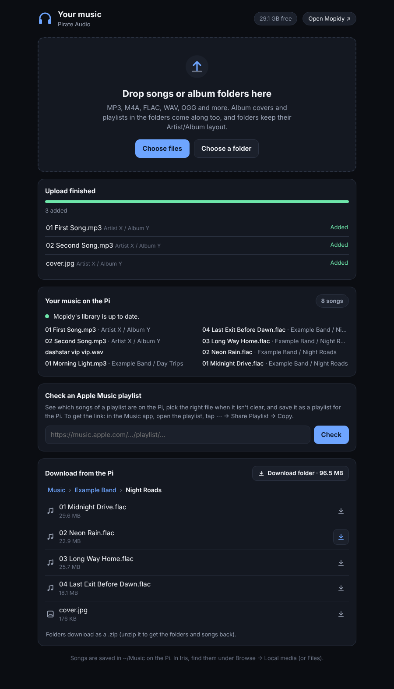

# Pirate Audio Bluetooth add-on

Pair your iPhone with your Raspberry Pi like a pair of headphones and listen through the **Pirate Audio's
headphone jack**. It works with no Wi-Fi or internet at all, so songs you've downloaded in Apple Music play
anywhere. The Pirate Audio's screen shows the song, artist, album art and progress, and the four buttons
control playback, for your phone and for the music stored on the Pi. Hold **A** for a music menu: browse
the Pi's artists, albums, songs, playlists and folders, see the queue, set repeat and shuffle, and switch
between your phone and the Pi's music.


It also adds a **drag-and-drop music upload page**: open `http://raspberrypi.local:6681` on your PC or phone,
drop songs or whole album folders on it, and they go straight into the Pi's Music folder, ready to play in
Mopidy.

**Pimoroni's Pirate Audio software keeps working.** Mopidy, its web page (Iris) and your music all stay, and
Mopidy keeps running the whole time. The one thing the installer changes in Mopidy's settings is switching
off its own now-playing screen and button handler (PiDi and raspberry-gpio), because the add-on now runs the
screen and buttons for both sources and does everything they did (and more). `uninstall.sh` switches them
back on. If you'd rather keep Pimoroni's screen, install with `--keep-pimoroni-screen`: the add-on then only
borrows the screen and buttons while your phone plays, without the music menu.

## What you need

- A Raspberry Pi with built-in Bluetooth (Zero 2 W, 3, 4 or 5) and a Pimoroni Pirate Audio board
- **Raspberry Pi OS Lite** (Bookworm or Trixie). The installer stops if it finds a desktop sound system.
- Pimoroni's Pirate Audio software (optional; the add-on also works on its own)

## Install

Copy this folder onto the Pi (from Windows PowerShell: `scp -r pirate-audio-bluetooth pi@raspberrypi.local:~`), then:

```bash
cd pirate-audio-bluetooth
bash install.sh --check   # see exactly what would change - changes nothing
bash install.sh           # install (it asks first)
```

Options: `--name "…"`, `--y-pin 20` for early boards, `--upload-port 8090` if port 6681 is taken,
`--no-upload` to skip the upload page, `--latency low` for less audio delay (see below),
`--keep-pimoroni-screen` (see above). Running `install.sh` again updates the add-on and keeps your settings.

Everything comes from Raspberry Pi OS packages, so nothing is compiled. The install takes a few minutes.

## Pair your phone (once)

1. The first time, the screen shows **Pairing mode** by itself. After that: hold **A** and pick
   **Pair a new phone**. Over SSH: `pirate-bluetooth pair`.
2. On the iPhone, go to **Settings → Bluetooth** and tap **Pirate Audio**.
3. Both screens show the same 6-digit code. Press **A** on the Pirate Audio and tap **Pair** on the iPhone.

After that it works like headphones. When you switch the Pi on, it connects to your iPhone by itself: it keeps
trying for 3 minutes, so it's fine if the phone is still in your pocket or asleep. You can also pick
**Pirate Audio** in Control Center at any time. Plug your headphones into the Pirate Audio and play.

## Add music from your PC or phone



Open **`http://raspberrypi.local:6681`** in a browser on the same Wi-Fi. Use your Pi's name if it isn't
`raspberrypi`. The exact address is also on the Pirate Audio's info screen: hold **A**.

- **On a PC:** drag songs or whole album folders onto the page, or use *Choose files* / *Choose a folder*.
  Folders keep their Artist/Album layout, and album covers and playlists inside them come along.
- **On an iPhone:** tap *Choose files* and pick songs from the Files app.
- **Songs already on the Pi** are recognised and not sent again, so you can re-drop a whole folder after adding
  a few songs to it.
- **Formats:** MP3, M4A/AAC, FLAC, WAV, AIFF, OGG, Opus and more. WAV files usually carry no artist or album
  info, so Mopidy lists them by file name (under *Tracks* and *Files*) rather than under an album.
- **Copy-protected Apple Music/iTunes files (`.m4p`) and non-music files** are skipped, and the page says why.
- **When the uploads finish,** Mopidy's library refreshes by itself in the background, with no restart and no
  interruption. The songs show up in Iris under *Browse → Local media* (or *Files*). If Mopidy couldn't read a
  song, or its library is switched off, the page says so.

The page only works on your local network. If you use the Pi on shared Wi-Fi (campus, café…), set a password
under `[upload]` in `settings.ini`, then run `systemctl --user restart pirate-upload`.

## Buttons

| Button | Now-playing screen | Hold |
|---|---|---|
| **A** (top left) | Play / pause | Music menu |
| **X** (top right) | Next song | Previous song |
| **B** (bottom left) | Volume down | Keeps going |
| **Y** (bottom right) | Volume up | Keeps going |

The buttons control whatever is on screen: your phone (its name is shown at the top) or the Pi's own music
(*Pi music* at the top, with ↻ for repeat and ⇄ for shuffle). Volume is like Pimoroni's: for the Pi's
music, B and Y change Mopidy's volume (the same one Iris shows); for the phone they turn the headphone amp
up and down, separately from the phone's own volume.

- **Code screen:** **A** accepts, **B** cancels.
- **Info screen:** **X** pairs a new phone, **A** closes it.
- **Screen off:** it turns off after 2 minutes with nothing playing. Any button wakes it; that first press
  only wakes it, so you don't skip a song by accident.

### The music menu (hold A)

| In the menu | |
|---|---|
| **X** / **Y** | Up / down (hold to scroll faster) |
| **A** | Open, or play the song |
| Hold **A** on a song or album | Add it to the queue |
| **B** | Back (closes the menu at the top) |

- **Switch to Pi music / Switch to your phone:** pauses one and carries on with the other.
- **Artists** → albums → songs, **Songs A–Z**, **Playlists** (from Iris, or uploaded `.m3u` files) and
  **Folders** (the Music folder as it is; handy for files without artist/album info, like most WAVs).
  Picking a song plays it with the rest of that album, list or folder queued after it.
- **Queue:** what's playing now (♪) and what's next; pick one to jump to it.
- **Repeat** (off, all, one song) and **Shuffle**.
- **Pair a new phone** and **Info** (name, connected phone, headphone volume, the upload page address).

Artists and Songs A–Z need Mopidy's music library (Mopidy-Local). If the menu says it's off, see
Troubleshooting.

### Switching between your phone and the Pi

- **Start music on your phone** and it takes over: the Pi's music stops at its spot.
- **Pick a song in the menu, or press play in Iris,** and the Pi's music takes over: your phone is paused.
- **Or use the menu's Switch item** to go back and forth. The Pi's music carries on from the same song and
  spot.

Only one of them can use the Pirate Audio's sound chip at a time, which is why the other one pauses.

### Right after you switch it on

The first press of **A** plays whatever you listened to last:

- **Your phone was last:** the screen shows *Connecting…*, then your phone's name. Press **A** and your
  phone starts playing.
- **The Pi's music was last:** your queue is back where it was, paused. Press **A** to carry on. Your phone
  still connects in the background.

### Album art

- **The Pi's music:** the album art inside your music files (through Mopidy's library), or a cover picture
  in the album's folder (`cover.jpg`, `folder.jpg`…).
- **Your phone:** phones can send album art over Bluetooth, but only to newer Bluetooth software than
  Raspberry Pi OS Bookworm has (it arrived in BlueZ 5.79; Trixie has it). On Bookworm, when the Pi is
  online, the add-on looks the cover up in Apple's iTunes catalogue by artist and album name (only those
  names are sent) and keeps a copy, so that album also has its art offline from then on. Set
  `art_lookup = no` under `[bluetooth]` in `settings.ini` to turn that off. Without art, the screen shows a
  colored card for each album.

## How it shares with Mopidy

- **Mopidy keeps running all the time.** The add-on talks to it over its web API, the same way Iris does,
  so Iris and the add-on's screen always agree.
- **Mopidy's queue survives reboots and power cuts.** Normally Mopidy starts empty after a reboot. The
  add-on writes the queue down while Mopidy runs and puts it back (paused, at the same spot) when Mopidy
  starts again. Mopidy's own settings aren't changed for this.
- **With `--keep-pimoroni-screen`** the add-on uses its older way: while your phone plays, Mopidy is paused
  out of the way and the add-on borrows the screen; a minute after the phone stops (or right away when it
  disconnects), "Back to Mopidy…" appears and Mopidy comes back with its queue where it was.

## Audio delay (latency)

Bluetooth audio always lags a little behind the phone. The Pi's share of that is the buffer it keeps to
ride out radio hiccups, and you can choose its size:

```bash
pirate-bluetooth latency          # show the current setting
pirate-bluetooth latency low      # about 0.1 s on the Pi: snappiest
pirate-bluetooth latency normal   # about 0.2 s (the default)
pirate-bluetooth latency safe     # about 0.5 s: BlueALSA's own default, most robust
```

A smaller buffer makes play/pause and volume feel quicker and brings videos closer to lip sync. The cost is
more chance of a crackle or dropout when the radio is busy, for example during a big Wi-Fi transfer (the
Pi's Wi-Fi and Bluetooth share one chip). If `low` crackles, go back to `normal`. The phone and the Bluetooth
link add roughly another 0.1-0.2 s that the Pi can't change.

## Commands

```bash
pirate-bluetooth                     # status: name, pairing mode, paired phones
pirate-bluetooth pair                # pairing mode for 3 minutes
pirate-bluetooth name "Kite's Pirate"
pirate-bluetooth forget "Kite's iPhone"   # or: forget all
pirate-bluetooth library             # is Mopidy's music library (Mopidy-Local) on?  "library on" fixes it
pirate-bluetooth latency low         # less audio delay (low / normal / safe)
pirate-bluetooth logs                # recent log lines; "logs -f" keeps watching
pirate-bluetooth logs upload         # just one part: screen, upload, audio or mopidy
```

Settings are in `~/.config/pirate-bluetooth/settings.ini`. They include how long it looks for your phone
after power-on (`reconnect_seconds`), the online album art lookup (`art_lookup`), when the screen turns off
(`sleep_after`, 0 = never), the Y-button pin on early boards, screen rotation and the volume step.
After editing, run `systemctl --user restart pirate-bluetooth`.

## Good to know

- **Apple Music downloads stay on your phone.** The phone plays them and sends the sound over Bluetooth, so
  offline listening works anywhere.
- **No album art over Bluetooth:** the screen draws a colored card for each album instead.
- Bluetooth audio uses a standard Bluetooth codec, so it's slightly lower quality than a wired or AirPlay
  connection, but fine for headphones.
- Everything starts at power-on, with no login needed. If your user services (Mopidy's included) only
  started at login before, the installer turns on "linger" for your user, as Pimoroni suggests for Mopidy.

## Troubleshooting

- **The iPhone doesn't list "Pirate Audio".** It only appears in pairing mode: hold A and pick *Pair a new
  phone*, or run `pirate-bluetooth pair`.
- **The phone doesn't connect by itself after power-on.** Check that the phone's Bluetooth is on and that
  it lists "Pirate Audio" under My Devices. The Pi only looks for 3 minutes after power-on; after that, press
  **A** or pick it in Control Center. If it never connects by itself, `pirate-bluetooth logs screen`
  shows what happened.
- **Connected, but no sound.** Press Y a few times (headphone volume) and check the phone's volume. Then check
  `systemctl status pirate-bluealsa pirate-bluealsa-aplay`.
- **Y does nothing.** Boards made before 23 January 2020 use BCM 20. Set `y_pin = 20` in `settings.ini`.
- **Picture upside down.** Set `rotation = 270` in `settings.ini`.
- **The upload page doesn't open.** Check that your PC or phone is on the same Wi-Fi as the Pi, and try the IP
  address from the info screen instead of `raspberrypi.local`. Then check `systemctl --user status pirate-upload`.
  Some campus and public networks block devices from reaching each other.
- **The screen stays dark, or the buttons do nothing.** `pirate-bluetooth logs screen` shows why. If
  Pimoroni's screen extension is still on (Mopidy's screen comes back), run `bash install.sh` again.
- **Uploaded songs don't show in Mopidy's Local media (or Iris's Artists/Albums/Tracks, or the menu's
  Artists and Songs A–Z).** They're always under *Browse → Files* (and the menu's *Folders*). If Local media is missing or stays empty, run `pirate-bluetooth library`. Pimoroni's
  installer saves Mopidy's settings as they were at install time, and if Mopidy-Local had a hiccup at that
  moment, it stays switched off from then on. `pirate-bluetooth library on` switches it back on: it adds one
  line to `~/.config/mopidy/mopidy.conf` (keeping a copy of the old file), restarts Mopidy with its queue
  put back, and adds your music to the library. `pirate-bluetooth logs upload` shows any songs Mopidy couldn't
  read.

## Uninstall

```bash
bash uninstall.sh           # undoes exactly what install.sh changed (it kept a record)
bash uninstall.sh --purge   # also removes settings.ini and the extra packages it installed
```

## What gets changed

| What | Where | Undone by uninstall.sh |
|---|---|---|
| BlueALSA package (Bluetooth audio) | `bluez-alsa-utils`, only if missing | removed |
| Bluetooth audio services | `pirate-bluealsa`, `pirate-bluealsa-aplay` | removed |
| "Pirate Headphone" volume control | a marked block in `/etc/asound.conf` (backed up) | removed |
| Audio delay setting | `/etc/default/pirate-bluetooth-latency` | removed |
| Shows up as headphones on phones | one line in `/etc/bluetooth/main.conf` (backed up) | original line put back |
| Screen/buttons/pairing program | `~/.local/share/pirate-bluetooth`, user service `pirate-bluetooth` | removed |
| `pirate-bluetooth` command | `/usr/local/bin` | removed |
| Music upload page | user service `pirate-upload` (port 6681) | removed; your uploaded music stays |
| Start at power-on | `loginctl enable-linger` for your user, only if it was off | turned back off |
| Mopidy's own screen and buttons | `enabled = false` under `[pidi]` and `[raspberry-gpio]` in `mopidy.conf` (not with `--keep-pimoroni-screen`) | switched back on |
| Mopidy's music library | only if you run `pirate-bluetooth library on`: `enabled = true` under `[local]` in `mopidy.conf` (old file kept as `mopidy.conf.before-library-on`) | left on (it's part of Pimoroni's setup) |
| **Not changed** | Mopidy's music, queue and other settings, default sound output, other sound cards, Wi-Fi, already-installed packages | |

## Credits

[BlueALSA](https://github.com/arkq/bluez-alsa) and [BlueZ](https://www.bluez.org/) do the Bluetooth work.
Pimoroni's [Pirate Audio](https://github.com/pimoroni/pirate-audio) software and
[st7789 library](https://github.com/pimoroni/st7789-python) drive the screen. Each is used under its own license.
