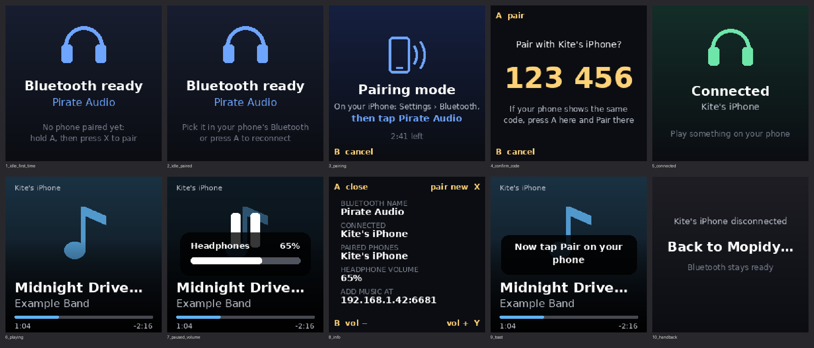

# Pirate Audio Bluetooth add-on

Pair your iPhone with your Raspberry Pi like a pair of headphones and listen through the **Pirate Audio's
headphone jack**. It works with no Wi-Fi or internet at all, so songs you've downloaded in Apple Music play
anywhere. While your phone plays, the Pirate Audio's screen shows the song, artist and progress, and the four
buttons control playback.



It also adds a **drag-and-drop music upload page**: open `http://raspberrypi.local:6681` on your PC or phone,
drop songs or whole album folders on it, and they go straight into the Pi's Music folder, ready to play in
Mopidy.

**Pimoroni's Pirate Audio software keeps working exactly as before.** Mopidy, its screen, its buttons, its web
page and your music files are all untouched, and so are their settings. While your phone is playing, the add-on
borrows the screen and buttons. When you stop (or disconnect), it gives them back with Mopidy's queue, track,
position, shuffle/repeat and volume put back where they were.

## What you need

- A Raspberry Pi with built-in Bluetooth (Zero 2 W, 3, 4 or 5) and a Pimoroni Pirate Audio board
- **Raspberry Pi OS Lite** (Bookworm or Trixie). The installer stops if it finds a desktop sound system.
- Pimoroni's Pirate Audio software (optional; the add-on also works on its own)

## Install

Copy this folder onto the Pi (from Windows PowerShell: `scp -r pirate-audio-bluetooth pi@raspberrypi.local:~`), then:

```bash
cd pirate-audio-bluetooth
bash install.sh --check   # see exactly what would change - changes nothing
bash install.sh           # install (it asks first)
```

Options: `--name "…"`, `--y-pin 20` for early boards, `--upload-port 8090` if port 6681 is taken,
`--no-upload` to skip the upload page, `--latency low` for less audio delay (see below). Running `install.sh` again updates the add-on and keeps your settings.

Everything comes from Raspberry Pi OS packages, so nothing is compiled. The install takes a few minutes.

## Pair your phone (once)

1. The first time, the screen shows **Pairing mode** by itself. After that: hold **A**, then press **X**.
   Over SSH: `pirate-bluetooth pair`.
2. On the iPhone, go to **Settings → Bluetooth** and tap **Pirate Audio**.
3. Both screens show the same 6-digit code. Press **A** on the Pirate Audio and tap **Pair** on the iPhone.

After that it works like headphones. When you switch the Pi on, it connects to your iPhone by itself: it keeps
trying for 3 minutes, so it's fine if the phone is still in your pocket or asleep. You can also pick
**Pirate Audio** in Control Center at any time. Plug your headphones into the Pirate Audio and play.

## Add music from your PC or phone


Open **`http://raspberrypi.local:6681`** in a browser on the same Wi-Fi. Use your Pi's name if it isn't
`raspberrypi`. The exact address is also on the Pirate Audio's info screen: hold **A**.

- **On a PC:** drag songs or whole album folders onto the page, or use *Choose files* / *Choose a folder*.
  Folders keep their Artist/Album layout, and album covers and playlists inside them come along.
- **On an iPhone:** tap *Choose files* and pick songs from the Files app.
- **Songs already on the Pi** are recognised and not sent again, so you can re-drop a whole folder after adding
  a few songs to it.
- **Formats:** MP3, M4A/AAC, FLAC, WAV, AIFF, OGG, Opus and more. WAV files usually carry no artist or album
  info, so Mopidy lists them by file name (under *Tracks* and *Files*) rather than under an album.
- **Copy-protected Apple Music/iTunes files (`.m4p`) and non-music files** are skipped, and the page says why.
- **When the uploads finish,** Mopidy's library refreshes by itself in the background, with no restart and no
  interruption. The songs show up in Iris under *Browse → Local media* (or *Files*). If Mopidy couldn't read a
  song, or its library is switched off, the page says so.

The page only works on your local network. If you use the Pi on shared Wi-Fi (campus, café…), set a password
under `[upload]` in `settings.ini`, then run `systemctl --user restart pirate-upload`.

## Buttons

| Button | While your phone plays | Hold |
|---|---|---|
| **A** (top left) | Play / pause | Info screen (name, phone, paired phones, volume, IP) |
| **X** (top right) | Next track | Previous track |
| **B** (bottom left) | Volume down | Keeps going |
| **Y** (bottom right) | Volume up | Keeps going |

- **Info screen:** **X** pairs a new phone, **A** closes it.
- **Code screen:** **A** accepts, **B** cancels.
- **Idle screen:** **A** connects your phone and starts its music.
- **When Bluetooth isn't playing:** the buttons and screen belong to Mopidy, exactly as before.

### Right after you switch it on

The first press of **A** plays whatever you listened to last:

- **Your phone was last:** the Bluetooth screen shows *Connecting…*, then your phone's name. Press **A** and
  your phone starts playing. Press **X** on that screen to use the Pi's own music (Mopidy) instead. If your
  phone doesn't turn up within 3 minutes, or you don't press anything for 5 minutes, Mopidy gets the screen.
- **The Pi's music (Mopidy) was last:** Mopidy's screen comes up with your queue back where it was,
  paused. Press **A** to carry on. Your phone still connects in the background, so you can start it from the
  phone whenever you like.

B and Y work like a volume knob on the headphone amp. They're separate from the phone's own volume.

## How it shares with Mopidy

- **Phone starts playing:** Mopidy's queue and settings are saved, Mopidy is paused out of the way, and the
  screen shows your phone's song.
- **Phone paused for a minute, or disconnected:** "Back to Mopidy…" appears, Mopidy starts again, and its
  queue comes back paused at the same spot, without making a sound.
- **A phone that just connects (without playing) doesn't interrupt Mopidy.** Your iPhone connecting
  after power-on won't stop the music.
- **Mopidy's queue survives reboots and power cuts.** Normally Mopidy starts empty after a reboot, so its
  play button did nothing. The add-on writes the queue down while Mopidy runs and puts it back (paused, at
  the same spot) when Mopidy starts again. Mopidy's own settings aren't changed for this.
- If the add-on ever crashes while Mopidy is paused out of the way, it restarts Mopidy when it comes back.

## Audio delay (latency)

Bluetooth audio always lags a little behind the phone. The Pi's share of that is the buffer it keeps to
ride out radio hiccups, and you can choose its size:

```bash
pirate-bluetooth latency          # show the current setting
pirate-bluetooth latency low      # about 0.1 s on the Pi: snappiest
pirate-bluetooth latency normal   # about 0.2 s (the default)
pirate-bluetooth latency safe     # about 0.5 s: BlueALSA's own default, most robust
```

A smaller buffer makes play/pause and volume feel quicker and brings videos closer to lip sync. The cost is
more chance of a crackle or dropout when the radio is busy, for example during a big Wi-Fi transfer (the
Pi's Wi-Fi and Bluetooth share one chip). If `low` crackles, go back to `normal`. The phone and the Bluetooth
link add roughly another 0.1-0.2 s that the Pi can't change.

## Commands

```bash
pirate-bluetooth                     # status: name, pairing mode, paired phones
pirate-bluetooth pair                # pairing mode for 3 minutes
pirate-bluetooth name "Kite's Pirate"
pirate-bluetooth latency low         # less audio delay (low / normal / safe)
pirate-bluetooth forget "Kite's iPhone"   # or: forget all
pirate-bluetooth library             # is Mopidy's music library (Mopidy-Local) on?  "library on" fixes it
pirate-bluetooth logs                # recent log lines; "logs -f" keeps watching
pirate-bluetooth logs upload         # just one part: screen, upload, audio or mopidy
```

Settings are in `~/.config/pirate-bluetooth/settings.ini`. They include how long the phone can stay paused
before Mopidy gets the screen back, how long it looks for your phone after power-on (`reconnect_seconds`),
how long it waits for the first press of A after power-on (`boot_wait`), the Y-button pin on early boards,
screen rotation and the volume step.
After editing, run `systemctl --user restart pirate-bluetooth`.

## Good to know

- **Apple Music downloads stay on your phone.** The phone plays them and sends the sound over Bluetooth, so
  offline listening works anywhere.
- **No album art over Bluetooth:** the screen draws a colored card for each album instead.
- Bluetooth audio uses a standard Bluetooth codec, so it's slightly lower quality than a wired or AirPlay
  connection, but fine for headphones.
- Everything starts at power-on, with no login needed. If your user services (Mopidy's included) only
  started at login before, the installer turns on "linger" for your user, as Pimoroni suggests for Mopidy.

## Troubleshooting

- **The iPhone doesn't list "Pirate Audio".** It only appears in pairing mode: hold A, then press X, or run
  `pirate-bluetooth pair`.
- **The phone doesn't connect by itself after power-on.** Check that the phone's Bluetooth is on and that
  it lists "Pirate Audio" under My Devices. The Pi only looks for 3 minutes after power-on; after that, press
  **A** or pick it in Control Center. If it never connects by itself, `pirate-bluetooth logs screen`
  shows what happened.
- **Connected, but no sound.** Press Y a few times (headphone volume) and check the phone's volume. Then check
  `systemctl status pirate-bluealsa pirate-bluealsa-aplay`.
- **Y does nothing.** Boards made before 23 January 2020 use BCM 20. Set `y_pin = 20` in `settings.ini`.
- **Picture upside down.** Set `rotation = 270` in `settings.ini`.
- **The upload page doesn't open.** Check that your PC or phone is on the same Wi-Fi as the Pi, and try the IP
  address from the info screen instead of `raspberrypi.local`. Then check `systemctl --user status pirate-upload`.
  Some campus and public networks block devices from reaching each other.
- **Uploaded songs don't show in Mopidy's Local media (or Iris's Artists/Albums/Tracks).** They're always
  under *Browse → Files*. If Local media is missing or stays empty, run `pirate-bluetooth library`. Pimoroni's
  installer saves Mopidy's settings as they were at install time, and if Mopidy-Local had a hiccup at that
  moment, it stays switched off from then on. `pirate-bluetooth library on` switches it back on: it adds one
  line to `~/.config/mopidy/mopidy.conf` (keeping a copy of the old file), restarts Mopidy with its queue
  put back, and adds your music to the library. `pirate-bluetooth logs upload` shows any songs Mopidy couldn't
  read.

## Uninstall

```bash
bash uninstall.sh           # undoes exactly what install.sh changed (it kept a record)
bash uninstall.sh --purge   # also removes settings.ini and the extra packages it installed
```

## What gets changed

| What | Where | Undone by uninstall.sh |
|---|---|---|
| BlueALSA package (Bluetooth audio) | `bluez-alsa-utils`, only if missing | removed |
| Bluetooth audio services | `pirate-bluealsa`, `pirate-bluealsa-aplay` | removed |
| "Pirate Headphone" volume control | a marked block in `/etc/asound.conf` (backed up) | removed |
| Audio delay setting | `/etc/default/pirate-bluetooth-latency` | removed |
| Shows up as headphones on phones | one line in `/etc/bluetooth/main.conf` (backed up) | original line put back |
| Screen/buttons/pairing program | `~/.local/share/pirate-bluetooth`, user service `pirate-bluetooth` | removed |
| `pirate-bluetooth` command | `/usr/local/bin` | removed |
| Music upload page | user service `pirate-upload` (port 6681) | removed; your uploaded music stays |
| Start at power-on | `loginctl enable-linger` for your user, only if it was off | turned back off |
| Mopidy's music library | only if you run `pirate-bluetooth library on`: `enabled = true` under `[local]` in `mopidy.conf` (old file kept as `mopidy.conf.before-library-on`) | left on (it's part of Pimoroni's setup) |
| **Not changed** | Mopidy and its config (unless you run `library on`), default sound output, other sound cards, Wi-Fi, already-installed packages | |

## Credits

[BlueALSA](https://github.com/arkq/bluez-alsa) and [BlueZ](https://www.bluez.org/) do the Bluetooth work.
Pimoroni's [Pirate Audio](https://github.com/pimoroni/pirate-audio) software and
[st7789 library](https://github.com/pimoroni/st7789-python) drive the screen. Each is used under its own license.
